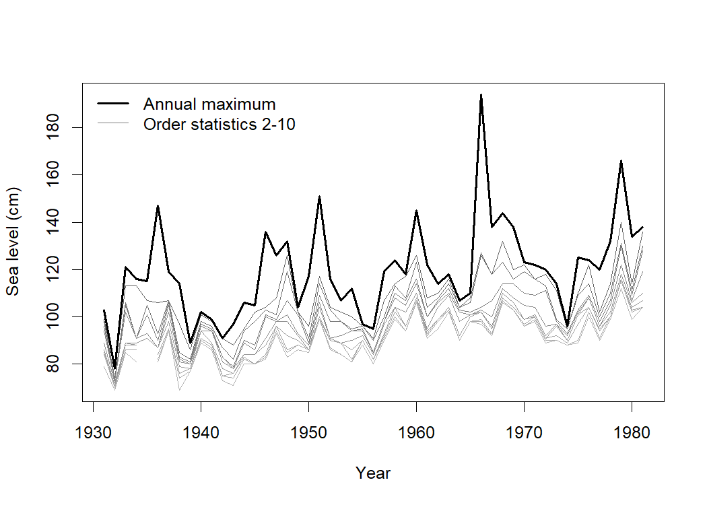
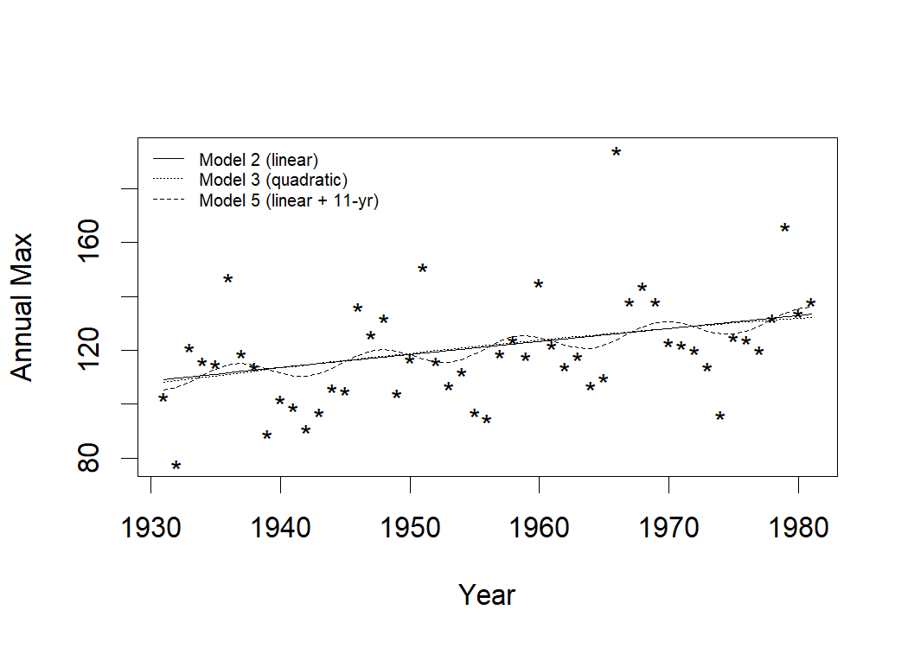

Goodness-of-Fit Tests for the r Largest Order Statistics Model: Venice
Sea Levels
================

- [Overview](#overview)
- [Repository structure](#repository-structure)
- [Reproducing the results](#reproducing-the-results)
- [Data](#data)
- [Results](#results)
  - [Likelihood ratio tests](#likelihood-ratio-tests)
  - [Parameter estimates (Model 2: linear
    trend)](#parameter-estimates-model-2-linear-trend)
  - [Fitted annual-maximum curves](#fitted-annual-maximum-curves)
  - [Goodness-of-fit p-values](#goodness-of-fit-p-values)
- [Citation](#citation)
- [License](#license)

# Overview

This repository contains the R code for the Venice sea-level analysis in
. It fits the **r largest order statistics** model to annual Venice sea
levels (51 years, 1931–1981, 10 largest values per year), compares
models with likelihood ratio tests, and applies a new
**parametric-bootstrap goodness-of-fit routine**, `rlarg.test()`, to
each order statistic.

# Repository structure

| File | Purpose |
|----|----|
| `R/00_data.R` | Loads and prepares the Venice data |
| `R/01_fit_models.R` | Fits models 1–5, likelihood ratio tests, fitted curves |
| `R/rlarg_test.R` | The `rlarg.test()` goodness-of-fit function |
| `R/02_gof_bootstrap.R` | Runs the bootstrap GoF tests for one random seed (slow) |
| `R/03_gof_summary.R` | Averages the p-values over all saved runs |
| `results/` | Saved bootstrap output, one file per seed |
| `figures/` | Figures generated when knitting |

# Reproducing the results

Run everything from the repository root. Required packages: `ismev`,
`dplyr` (plus `knitr`, `rmarkdown` and `kableExtra` to rebuild this
file).

``` r
source("R/00_data.R")          # data
source("R/01_fit_models.R")    # model fits, LRTs, fitted curves (fast)
```

The bootstrap (5000 simulations per model) is slow. Because of ties in
the data, results vary from run to run, so the paper averages **10
runs** with different seeds (123, 234, 501–508):

``` sh
Rscript R/02_gof_bootstrap.R 501    # writes results/Results501.txt; repeat for each seed
```

Then `source("R/03_gof_summary.R")` averages the files in `results/`. To
rebuild this page: `rmarkdown::render("README.Rmd")`.

# Data

Annual Venice sea levels: the 10 largest values (cm) in each year. The
bold line is the annual maximum (order statistic 1).

<!-- -->

# Results

## Likelihood ratio tests

| Comparison              | Deviance | df  |     p-value |
|:------------------------|---------:|:---:|------------:|
| 2 vs 1 (linear trend)   |  110.062 |  1  | **\<0.001** |
| 3 vs 2 (quadratic term) |    0.655 |  1  |       0.418 |
| 4 vs 2 (18.62-yr cycle) |    8.096 |  2  |   **0.018** |
| 5 vs 2 (11-yr cycle)    |   18.500 |  2  | **\<0.001** |

Each row tests a larger model against its simpler counterpart. Bold: p
\< 0.05.

## Parameter estimates (Model 2: linear trend)

|                | Parameter          | Estimate | Std. error |     z | p-value |
|:---------------|:-------------------|---------:|-----------:|------:|--------:|
| mu (intercept) | μ, intercept (cm)  |  104.520 |      1.667 | 62.69 | \<0.001 |
| mu (trend)     | μ, trend (cm/year) |    0.482 |      0.041 | 11.76 | \<0.001 |
| sigma          | σ (cm)             |   11.739 |      0.641 | 18.30 | \<0.001 |
| xi             | ξ                  |   -0.065 |      0.028 | -2.37 |   0.018 |

## Fitted annual-maximum curves

<!-- -->

## Goodness-of-fit p-values

Bootstrap p-values (averaged over runs) for the correlation (R),
Kolmogorov–Smirnov (KS), Cramér–von Mises (CvM) and Anderson–Darling
(AD) statistics, for each order statistic *k*. Models 7, 8 and 9 have
constant, linear-trend, and linear-trend + 11-year-cycle location
parameters.

# Citation

> \[Authors\]. (\[Year\]). *\[Publication title\]*. \[Journal\],
> [volume](%5Bissue%5D), \[pages\]. \[DOI\]

# License

\[Add license information, e.g. MIT.\]
