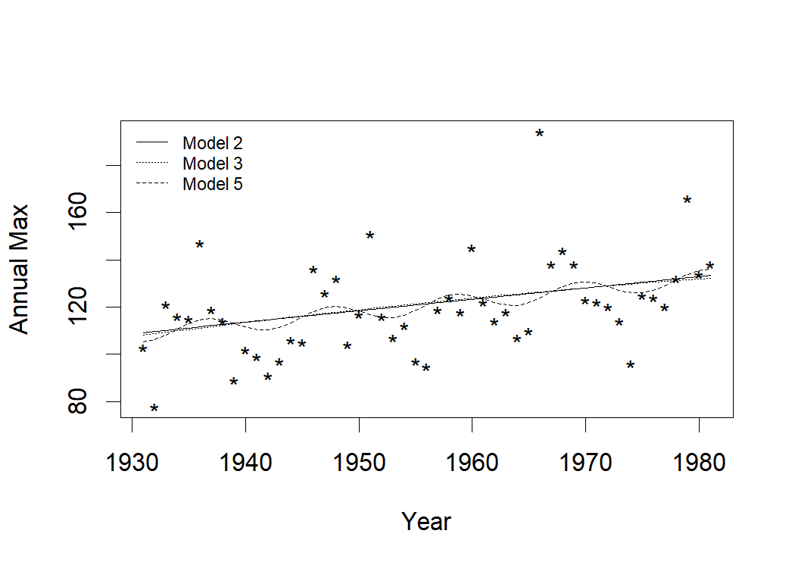

Goodness-of-Fit Tests for the r Largest Order Statistics Model: Venice
Sea-Level Analysis
================

- [Overview](#overview)
  - [Repository structure](#repository-structure)
  - [Requirements](#requirements)
  - [Controlling run time](#controlling-run-time)
- [Data](#data)
  - [Ties](#ties)
  - [Exploratory plot](#exploratory-plot)
- [Model fitting](#model-fitting)
  - [Parameter estimates (Model 2: linear
    trend)](#parameter-estimates-model-2-linear-trend)
  - [Negative log-likelihoods](#negative-log-likelihoods)
- [Likelihood ratio tests](#likelihood-ratio-tests)
- [Fitted location curves](#fitted-location-curves)
- [Standard `ismev` diagnostics](#standard-ismev-diagnostics)
- [Goodness-of-fit tests](#goodness-of-fit-tests)
  - [The `rlarg.test()` function](#the-rlargtest-function)
  - [Perturbing the data](#perturbing-the-data)
  - [Running the bootstrap](#running-the-bootstrap)
- [Summary across seeds](#summary-across-seeds)
  - [Table of averaged p-values](#table-of-averaged-p-values)
  - [Figure: p-values by order
    statistic](#figure-p-values-by-order-statistic)
  - [LaTeX-ready table (optional)](#latex-ready-table-optional)
- [Reproducing the paper’s results](#reproducing-the-papers-results)
- [Session information](#session-information)
- [Citation](#citation)
- [License](#license)

# Overview

This repository contains the R code used to produce the Venice sea-level
analysis in *\[Publication title\]*. It does three things:

1.  Fits the **r largest order statistics** (r-largest) model to the
    annual Venice sea-level data (51 years, 1931–1981, 10 largest values
    per year) with several trend/cycle specifications for the location
    parameter.
2.  Compares the nested models with **likelihood ratio tests** and plots
    the fitted location curves.
3.  Implements a new **parametric-bootstrap goodness-of-fit routine**
    (`rlarg.test()`) that applies four statistics – a probability-plot
    correlation, Kolmogorov–Smirnov (*D*), Cramér–von Mises (*W*), and
    Anderson–Darling (*A*) – to each of the r order statistics.

> **Note.** `README.md` is generated from `README.Rmd`. Edit the `.Rmd`
> and re-knit with `rmarkdown::render("README.Rmd")`; do not edit
> `README.md` by hand.

## Repository structure

    .
    ├── README.Rmd            # this document (source)
    ├── README.md             # knitted output displayed on GitHub
    ├── R/
    │   └── rlarg_test.R      # the rlarg.test() goodness-of-fit routine
    ├── data/
    │   └── venice.rda        # Venice data (optional; also ships with ismev)
    ├── results/              # bootstrap output, one file per random seed
    └── figures/              # figures generated when knitting

## Requirements

``` r
install.packages(c("ismev", "knitr", "rmarkdown", "dplyr"))
```

## Controlling run time

The bootstrap goodness-of-fit calculations (`nsim = 5000`, three models,
ten random seeds) take a long time, so they are **off by default** when
knitting. The final summary reads previously saved files in `results/`.
To re-run the simulations, set `run_gof <- TRUE` and choose a seed.

``` r
run_gof <- FALSE   # TRUE re-runs the bootstrap (slow)
nsim    <- 5000    # bootstrap replications per model
seed0   <- 508     # update the seed each time you re-run (see "Summary across seeds")
```

# Data

The data are the annual `venice` data set from the `ismev` package: the
ten largest sea levels (cm) for each year 1931–1981. Some years have
fewer than ten observations (missing values).

``` r
library(ismev)
library(dplyr)
if (file.exists("data/venice.rda")) load("data/venice.rda") else data(venice)
venice <- venice %>% filter(year %in% 1931:1981)
V2 <- venice[, 2:11]      # drop the Year column; keep the 10 order statistics
dim(V2)
```

    ## [1] 51 10

``` r
head(V2)
```

    ##     r1  r2  r3  r4  r5 r6 r7 r8 r9 r10
    ## 45 103  99  98  96  94 89 86 85 84  79
    ## 46  78  78  74  73  73 72 71 70 70  69
    ## 47 121 113 106 105 102 89 89 88 86  85
    ## 48 116 113  91  91  91 89 88 88 86  81
    ## 49 115 107 105 101  93 91 NA NA NA  NA
    ## 50 147 106  93  90  87 87 87 84 82  81

## Ties

Because the data are recorded to the nearest cm, ties among adjacent
order statistics within a year are common. This matters for
goodness-of-fit testing (see [Perturbing the
data](#perturbing-the-data)).

``` r
# number of ties between adjacent order statistics within a year
sum(V2[, 1:9] == V2[2:10], na.rm = TRUE)
```

    ## [1] 87

## Exploratory plot

``` r
matplot(1931:1981, as.matrix(V2), type = "l", lty = 1, col = grey.colors(10, end = 0.7),
        xlab = "Year", ylab = "Sea level (cm)")
lines(1931:1981, V2[, 1], lwd = 2)
legend("topleft", legend = c("Annual maximum", "Order statistics 2-10"),
       lwd = c(2, 1), col = c("black", "grey50"), bty = "n")
```

<figure>

<figcaption aria-hidden="true">The ten largest sea levels per year,
Venice 1931-1981.</figcaption>
</figure>

# Model fitting

All models are fit with `ismev::rlarg.fit()` using $r = 10$ order
statistics. The location parameter $\mu_t$ varies with time
$t = 1, \dots, 51$; the scale and shape parameters are held constant.

| Model | Location parameter $\mu_t$                       |
|-------|--------------------------------------------------|
| 1     | constant                                         |
| 2     | linear trend in $t$                              |
| 3     | quadratic trend in $t$                           |
| 4     | linear trend + 18.62-year sinusoid (nodal cycle) |
| 5     | linear trend + 11-year sinusoid (solar cycle)    |

``` r
mod1 <- rlarg.fit(V2, r = 10, mul = NULL, sigl = NULL, shl = NULL,
  mulink = identity, siglink = identity, shlink = identity,
  muinit = mean(V2[, 1]), siginit = sqrt(var(V2[, 1])), shinit = -0.001,
  show = FALSE, method = "Nelder-Mead", maxit = 10000)

mod2 <- rlarg.fit(V2, r = 10, ydat = matrix((1:51), ncol = 1), mul = 1,
  sigl = NULL, shl = NULL,
  mulink = identity, siglink = identity, shlink = identity,
  muinit = c(mean(V2[, 1]), 0), siginit = sqrt(var(V2[, 1])), shinit = -0.001,
  show = FALSE, method = "Nelder-Mead", maxit = 10000)

mod3 <- rlarg.fit(V2, r = 10,
  ydat = matrix(c((1:51), (1:51)^2), ncol = 2), mul = 1:2,
  sigl = NULL, shl = NULL,
  mulink = identity, siglink = identity, shlink = identity,
  muinit = c(mean(V2[, 1]), 0, 0), siginit = sqrt(var(V2[, 1])), shinit = -0.001,
  show = FALSE, method = "Nelder-Mead", maxit = 10000)

mod4 <- rlarg.fit(V2, r = 10,
  ydat = matrix(c((1:51), cos(2*pi*(1:51)/18.62), sin(2*pi*(1:51)/18.62)), ncol = 3),
  mul = 1:3, sigl = NULL, shl = NULL,
  mulink = identity, siglink = identity, shlink = identity,
  muinit = c(mean(V2[, 1]), 0, 0, 0), siginit = sqrt(var(V2[, 1])), shinit = -0.001,
  show = FALSE, method = "Nelder-Mead", maxit = 10000)

mod5 <- rlarg.fit(V2, r = 10,
  ydat = matrix(c((1:51), cos(2*pi*(1:51)/11), sin(2*pi*(1:51)/11)), ncol = 3),
  mul = 1:3, sigl = NULL, shl = NULL,
  mulink = identity, siglink = identity, shlink = identity,
  muinit = c(mean(V2[, 1]), 0, 0, 0), siginit = sqrt(var(V2[, 1])), shinit = -0.001,
  show = FALSE, method = "Nelder-Mead", maxit = 10000)
```

## Parameter estimates (Model 2: linear trend)

``` r
tab1 <- round(cbind(mod2$mle, mod2$se, mod2$mle / mod2$se,
                    2 * pnorm(-abs(mod2$mle / mod2$se))), 4)
dimnames(tab1) <- list(c("mu (intercept)", "mu (trend)", "sigma", "xi"),
                       c("Estimate", "Std. error", "z", "p-value"))
knitr::kable(tab1)
```

|                | Estimate | Std. error |       z | p-value |
|:---------------|---------:|-----------:|--------:|--------:|
| mu (intercept) | 104.5199 |     1.6672 | 62.6935 |  0.0000 |
| mu (trend)     |   0.4816 |     0.0410 | 11.7579 |  0.0000 |
| sigma          |  11.7392 |     0.6414 | 18.3028 |  0.0000 |
| xi             |  -0.0653 |     0.0275 | -2.3702 |  0.0178 |

## Negative log-likelihoods

``` r
nllh <- c(mod1$nllh, mod2$nllh, mod3$nllh, mod4$nllh, mod5$nllh)
knitr::kable(data.frame(Model = 1:5, `Negative log-likelihood` = round(nllh, 2),
                        check.names = FALSE))
```

| Model | Negative log-likelihood |
|------:|------------------------:|
|     1 |                 1139.09 |
|     2 |                 1084.06 |
|     3 |                 1083.73 |
|     4 |                 1080.01 |
|     5 |                 1074.81 |

# Likelihood ratio tests

Tests of each larger model against its simpler counterpart.

``` r
D1 <- 2 * (mod1$nllh - mod2$nllh)   # trend vs. constant      (1 df)
D2 <- 2 * (mod2$nllh - mod3$nllh)   # quadratic vs. linear    (1 df)
D3 <- 2 * (mod2$nllh - mod4$nllh)   # + 18.62-year cycle      (2 df)
D4 <- 2 * (mod2$nllh - mod5$nllh)   # + 11-year cycle         (2 df)

lrt <- data.frame(
  Comparison = c("2 vs 1 (linear trend)", "3 vs 2 (quadratic term)",
                 "4 vs 2 (18.62-yr cycle)", "5 vs 2 (11-yr cycle)"),
  Deviance   = round(c(D1, D2, D3, D4), 3),
  df         = c(1, 1, 2, 2),
  `p-value`  = signif(c(pchisq(D1, 1, lower.tail = FALSE),
                        pchisq(D2, 1, lower.tail = FALSE),
                        pchisq(D3, 2, lower.tail = FALSE),
                        pchisq(D4, 2, lower.tail = FALSE)), 3),
  check.names = FALSE)
knitr::kable(lrt)
```

| Comparison              | Deviance |  df |  p-value |
|:------------------------|---------:|----:|---------:|
| 2 vs 1 (linear trend)   |  110.062 |   1 | 0.00e+00 |
| 3 vs 2 (quadratic term) |    0.655 |   1 | 4.18e-01 |
| 4 vs 2 (18.62-yr cycle) |    8.096 |   2 | 1.75e-02 |
| 5 vs 2 (11-yr cycle)    |   18.500 |   2 | 9.61e-05 |

# Fitted location curves

Fitted location curves for annual maxima under Models 2, 3 and 5. The
predictions are shifted from the GEV-type location parameter $\mu_t$ to
the **median** of the annual maximum,
$\mu_t + \sigma(\log 2^{-\xi} - 1)/\xi$.

``` r
pred2 <- matrix(c(rep(1, 51), (1:51), rep(0, 51), rep(0, 51)), ncol = 4) %*% mod2$mle +
  (mod2$mle[3] * (log(2)^(-mod2$mle[4]) - 1) / mod2$mle[4])

pred3 <- matrix(c(rep(1, 51), (1:51), (1:51)^2, rep(0, 51), rep(0, 51)), ncol = 5) %*% mod3$mle +
  (mod3$mle[4] * (log(2)^(-mod3$mle[5]) - 1) / mod3$mle[5])

pred5 <- matrix(c(rep(1, 51), (1:51), cos(2*pi*(1:51)/11), sin(2*pi*(1:51)/11),
                  rep(0, 51), rep(0, 51)), ncol = 6) %*% mod5$mle +
  (mod5$mle[5] * (log(2)^(-mod5$mle[6]) - 1) / mod5$mle[6])

par(mfrow = c(1, 1), cex = 1.3)
plot(1931:1981, V2[, 1], xlab = "Year", ylab = "Annual Max", pch = "*")
lines(1931:1981, pred2, lty = 1)
lines(1931:1981, pred3, lty = 3)
lines(1931:1981, pred5, lty = 2)
legend("topleft", legend = c("Model 2", "Model 3", "Model 5"),
       lty = c(1, 3, 2), bty = "n", cex = 0.7)
```

<figure>

<figcaption aria-hidden="true">Annual maxima with fitted median curves:
linear (solid), quadratic (dotted), linear + 11-year cycle
(dashed).</figcaption>
</figure>

# Standard `ismev` diagnostics

These are the built-in diagnostics for Model 2 (not used in the paper).
They are included for completeness.

``` r
rlarg.diag(mod2)
```


# Goodness-of-fit tests

## The `rlarg.test()` function

`rlarg.test()` fits the model, computes four goodness-of-fit statistics
on each of the $r$ order statistics, and obtains bootstrap p-values by
simulating from the fitted model `nsim` times and refitting each
simulated data set. The returned matrix has $r$ rows (order statistics 1
to $r$) and 8 columns:

| Columns | Content |
|----|----|
| 1–4 | Observed statistics: probability-plot correlation (**lg**), Kolmogorov–Smirnov (**D**), Cramér–von Mises (**W**), Anderson–Darling (**A**) |
| 5–8 | Bootstrap p-values for the same four statistics |

The source is in [`R/rlarg_test.R`](R/rlarg_test.R) and is shown below.

``` r
# rlarg.test: goodness-of-fit tests for the r largest order statistics model
# (parametric bootstrap). Requires ismev::rlarg.fit.
#
# Returns an r x 8 matrix. Columns 1-4 are the observed statistics
# (probability-plot correlation, Kolmogorov-Smirnov D, Cramer-von Mises W,
# Anderson-Darling A) for each of the r order statistics; columns 5-8 are
# the corresponding bootstrap p-values.
rlarg.test=function(xdat, r = dim(xdat)[2], ydat = NULL, mul = NULL, sigl = NULL,
                    shl = NULL, mulink = identity, siglink = identity, shlink = identity,
                    muinit = NULL, siginit = NULL, shinit = NULL, show = TRUE,
                    method = "Nelder-Mead", maxit = 10000, nsim){
  fit1=rlarg.fit(xdat, r = r, ydat = ydat, mul = mul, sigl = sigl,
                 shl = shl, mulink = mulink, siglink = siglink, shlink = shlink,
                 muinit = muinit, siginit = siginit, shinit = shinit, show = show,
                 method = method, maxit = maxit)
  u1=sort(exp(-(1+fit1$vals[,3]*(xdat[,1]-fit1$vals[,1])/fit1$vals[,2])^(-1/fit1$vals[,3])))
  n=length(u1)
  plotpos=qnorm((1:n-0.5)/n)
  lg=cor(qnorm(u1),plotpos)
  d1<-max(c((1:n)/n-u1,u1-(0:(n-1))/n))
  w1<-sum((u1-((1:n)-0.5)/n)^2)+1/(12*n)
  a1<--sum((2*(1:n)-1)*log(u1)+(2*n+1-2*(1:n))*log(1-u1))/n-n
  ddf=matrix(nrow=r,ncol=4)
  ddf[1,]=c(lg,d1,w1,a1)
  for(k in 1:(r-1)){
    u1=sort(exp(
      -(1+fit1$vals[,3]*(xdat[,k+1]-fit1$vals[,1])/fit1$vals[,2])^(-1/fit1$vals[,3])
      +(1+fit1$vals[,3]*(xdat[,k]-fit1$vals[,1])/fit1$vals[,2])^(-1/fit1$vals[,3])
    ))
    n=length(u1)
    plotpos=qnorm((1:n-0.375)/(n+0.25))
    lg=cor(qnorm(u1),plotpos)
    d1<-max(c((1:n)/n-u1,u1-(0:(n-1))/n))
    w1<-sum((u1-((1:n)-0.5)/n)^2)+1/(12*n)
    a1<--sum((2*(1:n)-1)*log(u1)+(2*n+1-2*(1:n))*log(1-u1))/n-n
    ddf[k+1,]=c(lg,d1,w1,a1)
  }
  # simulation
  n=nrow(xdat)
  xsim=matrix(nrow=n,ncol=r)
  count=matrix(0,ncol=4,nrow=r)
  for(isim in 1:nsim){
    n=nrow(xdat)
    xsim[,1]=fit1$vals[,1]+fit1$vals[,2]*((-log(runif(n)))^(-fit1$vals[,3])-rep(1,n))/fit1$vals[,3]
    for(k in 1:(r-1)){
      n=nrow(xdat)
      xsim[,k+1]=fit1$vals[,1]+fit1$vals[,2]*((((-log(runif(n)))+(1+fit1$vals[,3]*(xsim[,k]-fit1$vals[,1])/fit1$vals[,2])
                                                ^(-1/fit1$vals[,3]))^(-fit1$vals[,3]))-1)/fit1$vals[,3]
    }
    for(i in 1:n){for(j in 1:r){if(is.na(xdat[i,j]))xsim[i,j]=NA}}
    fit2=rlarg.fit(xsim, r = r, ydat = ydat, mul = mul, sigl = sigl,
                   shl = shl, mulink = mulink, siglink = siglink, shlink = shlink,
                   muinit = muinit, siginit = siginit, shinit = shinit, show = show,
                   method = method, maxit = maxit)
    u1=sort(exp(-(1+fit2$vals[,3]*(xsim[,1]-fit2$vals[,1])/fit2$vals[,2])^(-1/fit2$vals[,3])))
    n=length(u1)
    plotpos=qnorm((1:n-0.375)/(n+0.25))
    lg2=cor(qnorm(u1),plotpos)
    d2<-max(c((1:n)/n-u1,u1-(0:(n-1))/n))
    w2<-sum((u1-((1:n)-0.5)/n)^2)+1/(12*n)
    a2<--sum((2*(1:n)-1)*log(u1)+(2*n+1-2*(1:n))*log(1-u1))/n-n
    ddf2=matrix(nrow=r,ncol=4)
    ddf2[1,]=c(lg2,d2,w2,a2)
    for(k in 1:(r-1)){
      u1=sort(exp(
        -(1+fit2$vals[,3]*(xsim[,k+1]-fit2$vals[,1])/fit2$vals[,2])^(-1/fit2$vals[,3])
        +(1+fit2$vals[,3]*(xsim[,k]-fit2$vals[,1])/fit2$vals[,2])^(-1/fit2$vals[,3])
      ))
      n=length(u1)
      plotpos=qnorm((1:n-0.5)/n)
      lg2=cor(qnorm(u1),plotpos)
      d2<-max(c((1:n)/n-u1,u1-(0:(n-1))/n))
      w2<-sum((u1-((1:n)-0.5)/n)^2)+1/(12*n)
      a2<--sum((2*(1:n)-1)*log(u1)+(2*n+1-2*(1:n))*log(1-u1))/n-n
      ddf2[k+1,]=c(lg2,d2,w2,a2)
    }
    count[,1]=count[,1]+(ddf2[,1]<ddf[,1])
    count[,2]=count[,2]+(ddf2[,2]>ddf[,2])
    count[,3]=count[,3]+(ddf2[,3]>ddf[,3])
    count[,4]=count[,4]+(ddf2[,4]>ddf[,4])
  }
  ddf=cbind(ddf,count/nsim)
  return(ddf)
}
```

## Perturbing the data

The Venice data contain many ties (87 between adjacent order
statistics), and the goodness-of-fit methods cannot be applied directly.
We therefore perturb each value by uniform noise on $(-0.5, 0.5)$ – the
rounding interval – and re-sort within each year.

> **Warning.** Because of the large number of ties, the resulting GoF
> statistics differ from run to run. The entire calculation was
> therefore repeated **10 times with different seeds** and the p-values
> averaged (see [Summary across seeds](#summary-across-seeds)).

``` r
V3 <- V2
set.seed(seed0)
for (i in 1:51) {
  rr <- 10
  if (i == 5) rr <- 6                       # year 5 has only 6 observations
  V3[i, 1:rr] <- V2[i, 1:rr] - 0.5 + runif(rr)
  V3[i, 1:rr] <- sort(as.numeric(V3[i, 1:rr]), decreasing = TRUE)
}
```

## Running the bootstrap

Three models are tested: Model 7 (constant location), Model 8 (linear
trend) and Model 9 (linear trend plus 11-year cycle).

``` r
T1 <- Sys.time()
mod7 <- rlarg.test(V3, r = 10, ydat = matrix((1:51), ncol = 1),
  mul = NULL, sigl = NULL, shl = NULL,
  mulink = identity, siglink = identity, shlink = identity,
  muinit = mean(V3[, 1]), siginit = sqrt(var(V3[, 1])), shinit = -0.001,
  show = FALSE, method = "Nelder-Mead", maxit = 10000, nsim = nsim)
print(Sys.time() - T1)
sum(mod7[, 5:8] < 0.05)

T1 <- Sys.time()
mod8 <- rlarg.test(V3, r = 10, ydat = matrix((1:51), ncol = 1),
  mul = 1, sigl = NULL, shl = NULL,
  mulink = identity, siglink = identity, shlink = identity,
  muinit = c(mean(V2[, 1]), 0), siginit = sqrt(var(V2[, 1])), shinit = -0.001,
  show = FALSE, method = "Nelder-Mead", maxit = 10000, nsim = nsim)
print(Sys.time() - T1)
sum(mod8[, 5:8] < 0.05)

T1 <- Sys.time()
mod9 <- rlarg.test(V3, r = 10,
  ydat = matrix(c((1:51), cos(2*pi*(1:51)/11), sin(2*pi*(1:51)/11)), ncol = 3),
  mul = 1:3, sigl = NULL, shl = NULL,
  mulink = identity, siglink = identity, shlink = identity,
  muinit = c(mean(V2[, 1]), 0, 0, 0), siginit = sqrt(var(V2[, 1])), shinit = -0.001,
  show = FALSE, method = "Nelder-Mead", maxit = 10000, nsim = nsim)
print(Sys.time() - T1)
sum(mod9[, 5:8] < 0.05)

# save results for this seed (30 rows x 8 columns: models 7, 8, 9 stacked)
modall <- rbind(mod7, mod8, mod9)
write(t(modall), file.path("results", paste0("Results", seed0, ".txt")), ncol = 8)
```

# Summary across seeds

Results from the ten runs (seeds 123, 234, 501–508) are stored in
`results/`. The p-values are averaged across runs.

``` r
fn <- file.path("results", c("Results123.txt", "Results234.txt", "Results501.txt",
  "Results502.txt", "Results503.txt", "Results504.txt", "Results505.txt",
  "Results506.txt", "Results507.txt", "Results508.txt"))
fn <- fn[file.exists(fn)]

if (length(fn) == 0) {
  cat("No result files found in results/. Set run_gof <- TRUE and re-knit, or add the saved Results*.txt files.")
} else {
  cat("Averaging over", length(fn), "run(s).\n")
  mod7all <- mod8all <- mod9all <- 0
  for (f in fn) {
    M <- matrix(scan(f, quiet = TRUE), ncol = 8, byrow = TRUE)
    mod7all <- mod7all + M[1:10,  5:8]
    mod8all <- mod8all + M[11:20, 5:8]
    mod9all <- mod9all + M[21:30, 5:8]
  }
  mod7all <- mod7all / length(fn)
  mod8all <- mod8all / length(fn)
  mod9all <- mod9all / length(fn)

  # number of p-values below 0.05 (out of 40 per model)
  c(`Model 7` = sum(mod7all < 0.05),
    `Model 8` = sum(mod8all < 0.05),
    `Model 9` = sum(mod9all < 0.05))
}
```

    ## No result files found in results/. Set run_gof <- TRUE and re-knit, or add the saved Results*.txt files.

## Table of averaged p-values

Rows are the order statistics $k = 1, \dots, 10$. Columns give the
p-value for the correlation (**R**), Kolmogorov–Smirnov (**KS**),
Cramér–von Mises (**CvM**) and Anderson–Darling (**AD**) statistics.

``` r
nm <- c("R", "KS", "CvM", "AD")
tab <- data.frame(k = 1:10,
                  signif(mod7all, 2), signif(mod8all, 2), signif(mod9all, 2))
names(tab) <- c("k", paste0("M7.", nm), paste0("M8.", nm), paste0("M9.", nm))
knitr::kable(tab, align = "c")
```

## Figure: p-values by order statistic

``` r
par(mfrow = c(1, 3), mar = c(4, 4, 3, 1))
res <- list(`Model 7: constant` = mod7all,
            `Model 8: linear trend` = mod8all,
            `Model 9: trend + 11-yr cycle` = mod9all)
for (nmod in names(res)) {
  matplot(1:10, res[[nmod]], type = "b", pch = 1:4, lty = 1, col = 1:4,
          ylim = c(0, 1), xlab = "Order statistic k", ylab = "p-value", main = nmod)
  abline(h = 0.05, lty = 2)
}
legend("bottomright", legend = nm, pch = 1:4, col = 1:4, lty = 1, bty = "n", cex = 0.8)
```

## LaTeX-ready table (optional)

This produces rows that can be pasted straight into a LaTeX `tabular`.

``` r
for (i in 1:10) {
  print(paste0(
    signif(mod7all, 2)[i, 1], "&", signif(mod7all, 2)[i, 2], "&",
    signif(mod7all, 2)[i, 3], "&", signif(mod7all, 2)[i, 4], "&",
    signif(mod8all, 2)[i, 1], "&", signif(mod8all, 2)[i, 2], "&",
    signif(mod8all, 2)[i, 3], "&", signif(mod8all, 2)[i, 4], "&",
    signif(mod9all, 2)[i, 1], "&", signif(mod9all, 2)[i, 2], "&",
    signif(mod9all, 2)[i, 3], "&", signif(mod9all, 2)[i, 4], "\\\\"))
}
```

# Reproducing the paper’s results

1.  Install the required packages (see [Requirements](#requirements)).
2.  Knit this file for the model fits, tests, and figures:
    `rmarkdown::render("README.Rmd")`.
3.  To regenerate the bootstrap results, set `run_gof <- TRUE` in the
    `controls` chunk, set `seed0` to a new value, and re-knit. Repeat
    with ten different seeds, keeping the `Results<seed>.txt` files in
    `results/` (add the new file names to the `fn` vector in the summary
    chunk).

# Session information

``` r
sessionInfo()
```

    ## R version 4.5.2 (2025-10-31 ucrt)
    ## Platform: x86_64-w64-mingw32/x64
    ## Running under: Windows 11 x64 (build 26200)
    ## 
    ## Matrix products: default
    ##   LAPACK version 3.12.1
    ## 
    ## locale:
    ## [1] LC_COLLATE=English_United States.utf8 
    ## [2] LC_CTYPE=English_United States.utf8   
    ## [3] LC_MONETARY=English_United States.utf8
    ## [4] LC_NUMERIC=C                          
    ## [5] LC_TIME=English_United States.utf8    
    ## 
    ## time zone: America/New_York
    ## tzcode source: internal
    ## 
    ## attached base packages:
    ## [1] stats     graphics  grDevices utils     datasets  methods   base     
    ## 
    ## other attached packages:
    ## [1] dplyr_1.1.4  ismev_1.43   mgcv_1.9-3   nlme_3.1-168
    ## 
    ## loaded via a namespace (and not attached):
    ##  [1] vctrs_0.6.5       cli_3.6.5         knitr_1.50        rlang_1.1.6      
    ##  [5] xfun_0.54         generics_0.1.4    glue_1.8.0        htmltools_0.5.8.1
    ##  [9] rmarkdown_2.29    grid_4.5.2        evaluate_1.0.5    tibble_3.3.0     
    ## [13] fastmap_1.2.0     yaml_2.3.10       lifecycle_1.0.4   compiler_4.5.2   
    ## [17] pkgconfig_2.0.3   rstudioapi_0.19.0 lattice_0.22-7    digest_0.6.37    
    ## [21] R6_2.6.1          tidyselect_1.2.1  pillar_1.11.0     splines_4.5.2    
    ## [25] magrittr_2.0.3    Matrix_1.7-4      tools_4.5.2

# Citation

If you use this code, please cite:

> \[Authors\]. (\[Year\]). *\[Publication title\]*. \[Journal\],
> [volume](%5Bissue%5D), \[pages\]. \[DOI\]

# License

\[Add license information, e.g. MIT.\]
